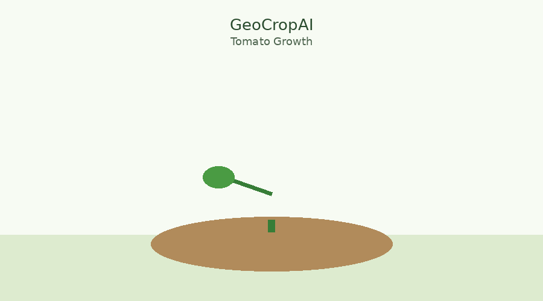
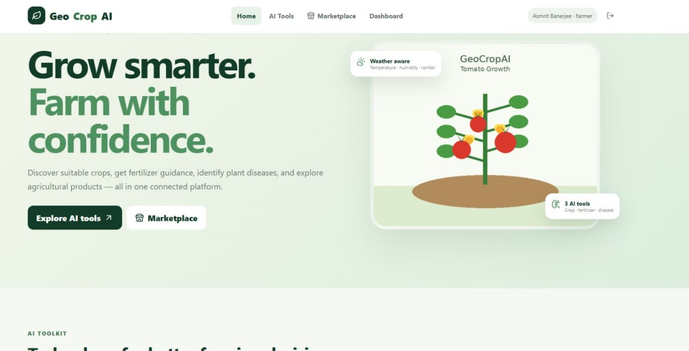

<div align="center">



# 🌱 GeoCropAI

### AI-Powered Precision Agriculture & Marketplace

*Smarter farming decisions. Direct connection with buyers.*

<br>


<br>

[🚀 Features](#-key-features) •
[🧰 Tech Stack](#-technology-stack) •
[🏛️ Architecture](#-system-architectureworkflow) •
[⚙️ Setup](#️-installation-and-setup) •
[🧠 ML](#-machine-learning) •
[🔮 Future](#-future-enhancements) •
[👥 Team](#-contributors)

</div>

---

GeoCropAI is a machine-learning-powered agriculture platform designed to help farmers make informed farming decisions and connect directly with buyers through an integrated agricultural marketplace.

The project combines machine learning, a web application, and digital product listings to support smarter agricultural decisions and simplify the buying and selling of agricultural products.

## 📊 Data Source

| Dataset | Link |
|---|---|
| 🌾 Crop recommendation dataset | [View on Kaggle](https://www.kaggle.com/atharvaingle/crop-recommendation-dataset) |
| 🧪 Fertilizer suggestion dataset | [View on Kaggle](https://www.kaggle.com/datasets/gdabhishek/fertilizer-prediction) |

---

## 🚀 Key Features

<table>
<tr>
<td width="33%" valign="top">

### 🌾 Machine Learning for Agriculture
- **Crop Recommendation:** Helps users identify suitable crops based on agricultural input parameters.
- **Fertilizer Recommendation:** Provides fertilizer recommendations using a trained machine-learning model.
- **Model Integration:** Integrates trained ML models with the backend for prediction services.

</td>
<td width="33%" valign="top">

### 🛒 Agricultural Marketplace
- **Farmer Listings:** Farmers can list agricultural products for sale.
- **Product Image Upload:** Supports uploading product images through Cloudinary integration.
- **Product Details:** Displays product name, category, description, price, quantity, unit, and location.
- **Buyer Experience:** Buyers can browse available products and view their details.
- **Product Cards:** Presents marketplace listings through a structured, image-based interface.

</td>
<td width="33%" valign="top">

### 🔐 Backend and Data Management
- FastAPI-based REST API.
- MongoDB integration for application data.
- Authentication and account management.
- API endpoints connecting the frontend, marketplace, and machine-learning models.

</td>
</tr>
</table>

---

## 🧰 Technology Stack

| Component | Technologies |
|---|---|
| 🎨 **Frontend** |    |
| ⚙️ **Backend** |   |
| 🗄️ **Database** |  |
| 🤖 **Machine Learning** |   |
| 🖼️ **Image Storage** |  |
| 🔗 **API Communication** | REST API, JSON, multipart form data |
| 🛠️ **Development Tools** |    Uvicorn |

---

## 🏛️ System Architecture/Workflow

```bash
                   ┌─────────────────────┐
                   │        User         │
                   │  Farmers & Buyers   │
                   └──────────┬──────────┘
                              │
                              ▼
                   ┌─────────────────────┐
                   │   React Frontend    │
                   │  JavaScript + CSS   │
                   └──────────┬──────────┘
                              │  REST API (JSON / multipart)
                              ▼
                   ┌─────────────────────┐
                   │   FastAPI Backend   │
                   │ REST API Endpoints  │
                   └──────────┬──────────┘
                              │
         ┌────────────────────┼────────────────────┐
         ▼                    ▼                    ▼
 ┌─────────────────┐  ┌─────────────────┐  ┌─────────────────┐
 │  ML Prediction  │  │   Marketplace   │  │ Auth & Accounts │
 │Crop + Fertilizer│  │ Product Listings│  │      (JWT)      │
 └────────┬────────┘  └────────┬────────┘  └────────┬────────┘
          │                    │                    │
          ▼                    ▼                    ▼
 ┌─────────────────┐  ┌─────────────────┐  ┌─────────────────┐
 │  scikit-learn   │  │     MongoDB     │  │     MongoDB     │
 │ (Trained Models)│  │  + Cloudinary   │  │     (Users)     │
 └─────────────────┘  └─────────────────┘  └─────────────────┘
```

### 🤖 ML Pipeline

```bash
Agricultural Input Parameters
            ↓
   React Frontend Form
            ↓
 FastAPI Prediction Endpoint
            ↓
 Trained ML Model (scikit-learn)
            ↓
Crop / Fertilizer Recommendation
```

### 🛒 Marketplace Pipeline

```bash
Farmer: Product Details + Image
            ↓
     React Frontend
            ↓
      FastAPI Backend
            ↓
 ┌──────────┴───────────┐
 ▼                      ▼
Cloudinary           MongoDB
(Product Image)   (Product Details)
 └──────────┬───────────┘
            ↓
Buyer: Browse Product Cards
            ↓
   View Product Details
```

---

## 🖥️ Home Page of our WebApplication

<div align="center">



</div>

---

## 🏗️ Project Structure

```text
GeoCropAI/
├── backend/                  # FastAPI backend and API routes
├── frontend/                 # Frontend application
│   └── src/
│       ├── App.jsx           # Main application interface
│       ├── api.js            # Frontend API integration
│       └── ...
├── dataset/                  # Datasets used for ML tasks
├── models/                   # Trained machine-learning models
├── utils/                    # Helper utilities
├── train_crop_model.py       # Crop model training
├── train_fertilizer_model.py # Fertilizer model training
├── requirements.txt          # Python dependencies
├── .gitignore
└── README.md
```

> [!NOTE]
> The structure above describes the main project components; individual filenames may vary as the project evolves.

---

## ⚙️ Installation and Setup

### 1️⃣ Clone the Repository

```bash
git clone https://github.com/mandrita16/GeoCropAI.git
cd GeoCropAI
```

### 2️⃣ Set Up the Python Environment

```bash
python -m venv venv
```

Activate the environment on Windows:

```powershell
.\venv\Scripts\Activate.ps1
```

Install the dependencies:

```bash
pip install -r requirements.txt
```

### 3️⃣ Configure Environment Variables

Create a `.env` file in the project root and configure the environment variables required by the backend.

```env
MONGO_URI=your_mongodb_connection_string
JWT_SECRET=your_secure_random_secret
CLOUDINARY_URL=your_cloudinary_connection_url
```

Use the exact variable names expected by your backend configuration. Replace the example values with your own credentials.

> [!WARNING]
> **Never commit `.env` or expose API keys, database credentials, or secrets publicly.**

### 4️⃣ Start the Backend

From the project root, run:

```bash
uvicorn backend.main:app --reload
```

The backend should start on the local development server, typically:

```text
http://127.0.0.1:8000
```

If enabled by the application, interactive API documentation is available at:

```text
http://127.0.0.1:8000/docs
```

### 5️⃣ Start the Frontend

Open a separate terminal:

```bash
cd frontend
npm install
npm run dev
```

Open the local URL displayed by the frontend development server.

Ensure that the frontend API configuration points to the running backend.

<details>
<summary><b>⚡ Quick Setup (click to expand)</b></summary>

<br>

If Python, Node.js, and Git are already installed, the basic setup is:

```bash
git clone https://github.com/mandrita16/GeoCropAI.git
cd GeoCropAI
python -m venv venv
.\venv\Scripts\Activate.ps1
pip install -r requirements.txt
uvicorn backend.main:app --reload
```

Then, in a separate terminal:

```bash
cd frontend
npm install
npm run dev
```

</details>

---

## 🔄 Application Workflow

1. A user accesses the GeoCropAI frontend.
2. The frontend communicates with the FastAPI backend.
3. Users can access supported agricultural prediction features.
4. Farmers can create product listings and upload product images.
5. Product information is processed by the backend, while images are uploaded through the configured Cloudinary integration.
6. Buyers can browse available agricultural products and review their details.

---

## 🧠 Machine Learning

GeoCropAI includes scripts for training crop and fertilizer recommendation models.

```bash
python train_crop_model.py
python train_fertilizer_model.py
```

The trained models are stored in the project’s model directory, subject to the configured training scripts. Ensure that the required datasets and model dependencies are available before training.

---

## 🔒 Security Considerations

- 🔑 Keep database credentials and JWT secrets in environment variables.
- 🚫 Do not commit `.env` files or private credentials.
- ✅ Validate user input and uploaded files on the backend.
- 🛡️ Configure appropriate authentication and authorization for protected endpoints.
- 🏭 Use secure production settings before deployment.

---

## 🎯 Project Objectives

- 🌾 Apply machine learning to agricultural decision-making.
- 🛒 Provide an integrated digital marketplace for agricultural products.
- 📸 Enable farmers to publish product listings with images and relevant details.
- 🔗 Connect frontend workflows with backend APIs and database services.
- 🧩 Build a modular application that can be extended with additional agricultural features.

---

## 🔮 Future Enhancements

- [ ] 📈 Real-time agricultural market price information.
- [ ] 🍃 Advanced crop disease detection.
- [ ] ⛅ Weather-based crop planning.
- [ ] 📦 Order management and transaction tracking.
- [ ] 📊 Improved analytics for farmers and buyers.
- [ ] ☁️ Cloud deployment and production monitoring.

---

## 👥 Contributors

### GeoCropAI Team

<div align="center">

| 👩‍💻 Contributor |
|:---:|
| **Mandrita Dasgupta** |
| **Debdeep Ghosh** |
| **Pijush Pakrashi** |
| **Asmrit Banerjee** |

</div>

Developed collaboratively as part of the GeoCropAI project.

---

## 📄 License

Refer to the repository's existing license for the applicable terms of use and distribution.

<div align="center">

<br>

**Made with 🌱 for farmers**

[⬆ Back to top](#-geocropai)

</div>
